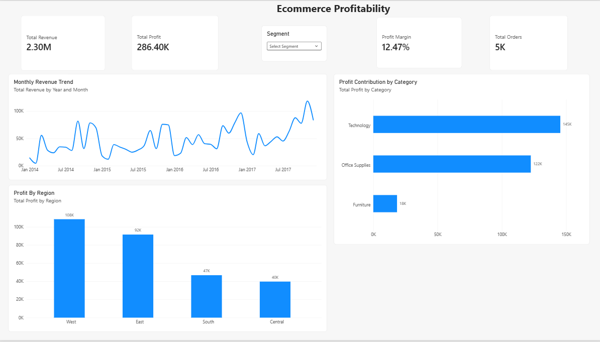
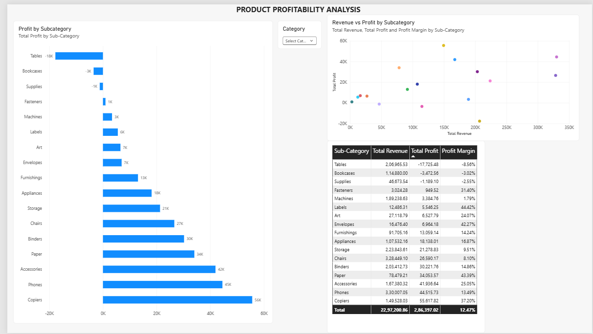
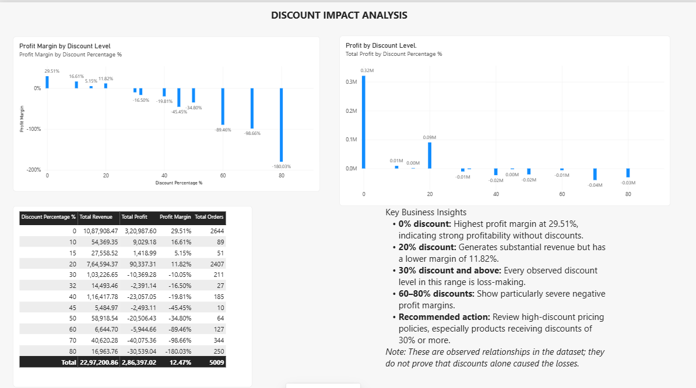

# E-commerce Profitability and Revenue Intelligence

An end-to-end data analytics project using **PostgreSQL, SQL, Power BI, and DAX** to investigate revenue, profitability, product performance, regional trends, and discount strategies in a retail business.

## Project Overview

Revenue growth does not necessarily mean improved business performance. A company may generate high sales while losing profit through unprofitable products, pricing decisions, or excessive discounting.

This project analyzes the Sample Superstore retail dataset to identify profitability gaps, understand business performance, and develop data-driven recommendations.

## Business Problem

The business is generating substantial revenue, but management needs to understand whether that revenue is translating into profit.

The analysis focuses on answering these questions:

- Which product categories and sub-categories generate the highest and lowest profits?
- Which regions contribute most to revenue and profitability?
- Which customer segments have the strongest profit margins?
- How are discount levels associated with profitability?
- Which areas should management investigate to reduce potential profit leakage?

## Tools and Technologies

| Tool | Purpose |
|---|---|
| PostgreSQL | Data storage and querying |
| SQL | Data profiling and business analysis |
| Power BI | Interactive dashboard development |
| DAX | Measures and calculated columns |
| Git and GitHub | Version control and project documentation |

## Dataset

**Dataset:** Sample Superstore

The dataset contains retail transaction-level information, including:

- Order and shipping dates
- Customer details and segments
- Product categories and sub-categories
- Sales, quantity, discount, and profit
- Geographic information such as city, state, and region

The dataset contains approximately 9,994 order lines.

The raw dataset is excluded from this repository to keep it lightweight. Refer to [`Data/README.md`](Data/README.md) for dataset information.

## Project Workflow

1. Imported the Sample Superstore dataset into PostgreSQL.
2. Performed data profiling and examined the dataset structure.
3. Analyzed overall revenue, profit, and profit margins.
4. Evaluated regional and customer segment performance.
5. Investigated the relationship between discount levels and profitability.
6. Identified loss-making product categories and sub-categories.
7. Created DAX measures and calculated columns in Power BI.
8. Developed an interactive dashboard to communicate business findings.

## SQL Analysis

The SQL analysis is divided into six scripts:

| SQL File | Description |
|---|---|
| `01_data_profiling.sql` | Dataset structure and data profiling |
| `02_revenue_profit_analysis.sql` | Overall revenue and profit analysis |
| `03_regional_analysis.sql` | Regional sales and profitability |
| `04_customer_segment_analysis.sql` | Customer segment performance |
| `05_discount_analysis.sql` | Discount levels and profitability |
| `06_profit_leak_analysis.sql` | Identification of loss-making areas |

### Key Metrics

- **Total Revenue:** `SUM(Sales)`
- **Total Profit:** `SUM(Profit)`
- **Profit Margin:** `SUM(Profit) / SUM(Sales)`
- **Total Orders:** `COUNT(DISTINCT Order ID)`
- **Loss-making Order Lines:** Count of order lines where profit is negative.

Profit margin is calculated using aggregate profit divided by aggregate revenue, rather than averaging individual transaction margins.

## Power BI Dashboard

The Power BI report contains three interactive analytical pages.

### 1. Executive Overview

Provides a high-level view of business performance.

- Total revenue
- Total profit
- Profit margin
- Total orders
- Monthly revenue trend
- Profit by category
- Profit by region
- Customer segment slicer

### 2. Product Profitability

Examines the profitability of different product categories and sub-categories.

- Profit by sub-category
- Revenue versus profit comparison
- Revenue, profit, and profit margin by sub-category
- Category filtering

### 3. Discount Impact

Investigates how different discount levels are associated with changes in profitability.

- Profit margin by discount level
- Total profit by discount level
- Revenue and profit by discount level
- Order counts by discount level
- Key business insights

## Dashboard Screenshots

### Executive Overview



### Product Profitability



### Discount Impact



The interactive Power BI report is available in [`powerbi/Ecommerce_Profitability_Analysis.pbix`](powerbi/Ecommerce_Profitability_Analysis.pbix).

## Key Business Findings

### 1. Overall Business Performance

| Metric | Result |
|---|---:|
| Total Revenue | ~$2.30 million |
| Total Profit | ~$286,397 |
| Profit Margin | ~12.47% |
| Total Orders | 5,009 |
| Loss-making Order Lines | 1,871 |

Approximately **18.72% of order lines generated negative profit**.

### 2. Product Profitability

| Category | Revenue | Profit | Profit Margin |
|---|---:|---:|---:|
| Technology | $836,155 | $145,455 | 17.40% |
| Office Supplies | $719,048 | $122,491 | 17.04% |
| Furniture | $741,999 | $18,451 | 2.49% |

Key observations:

- Technology generated the highest category profit.
- Furniture generated substantial revenue but had a comparatively low profit margin.
- Tables generated a loss of approximately **$17,725**.
- Bookcases generated a loss of approximately **$3,473**.

### 3. Regional Performance

- West generated the highest regional profit, approximately **$108,418**.
- Central generated the lowest regional profit, approximately **$39,706**.
- Central also had the lowest regional profit margin, approximately **7.92%**.

### 4. Customer Segment Performance

- Consumer generated the highest revenue and total profit.
- Home Office had the highest profit margin, approximately **14.03%**.
- Corporate had a profit margin of approximately **13.03%**.

### 5. Discount Analysis

- Transactions with no discount had an aggregate profit margin of approximately **29.51%**.
- Discount levels of 30% and above showed negative aggregate profit margins in this dataset.
- The 70% and 80% discount groups had particularly severe negative margins.

These results indicate an association between higher discount levels and weaker profitability. They do not prove that discounts alone caused the losses; product mix, costs, and other factors may also contribute.

## Business Recommendations

Based on the analysis:

1. **Review Furniture profitability:** Investigate pricing, costs, and product-level performance for Tables and Bookcases.
2. **Reassess discount policies:** Review high-discount transactions and evaluate promotional profitability before approving discounts.
3. **Investigate Central region:** Examine its product mix, pricing, and discount patterns to understand its lower margin.
4. **Study high-margin segments:** Investigate the purchasing patterns and product mix contributing to Home Office profitability.
5. **Monitor profit alongside revenue:** Track profit margin and total profit instead of relying on revenue growth alone.

## Project Structure

```text
E-commerce_Profitability_and_Revenue_Intelligence/
│
├── Data/
│   └── README.md
│
├── powerbi/
│   └── Ecommerce_Profitability_Analysis.pbix
│
├── screenshots/
│   ├── executive-overview.png
│   ├── product-profitability.png
│   └── discount-impact.png
│
├── sql/
│   ├── 01_data_profiling.sql
│   ├── 02_revenue_profit_analysis.sql
│   ├── 03_regional_analysis.sql
│   ├── 04_customer_segment_analysis.sql
│   ├── 05_discount_analysis.sql
│   └── 06_profit_leak_analysis.sql
│
├── .gitignore
└── README.md
```

## How to Explore the Project

1. Clone this repository:

   ```bash
   git clone https://github.com/apurva2074/ecommerce-profitability-analysis.git
   ```

2. Obtain the Sample Superstore dataset and place the raw file in `Data/raw/`.

3. Import the dataset into PostgreSQL.

4. Execute the SQL scripts in the `sql/` directory.

5. Open `powerbi/Ecommerce_Profitability_Analysis.pbix` using Power BI Desktop.

6. Configure the PostgreSQL connection if prompted.

## Limitations

- The analysis is based on historical transactional data.
- The relationship between discounts and profitability is observational and does not establish causation.
- Business recommendations require further investigation of product costs, pricing, and customer behavior before implementation.
- The hypothetical profit impact of changing discount strategies should not be treated as guaranteed recoverable profit.

## Author

**Apurva Mane**

[GitHub Profile](https://github.com/apurva2074)